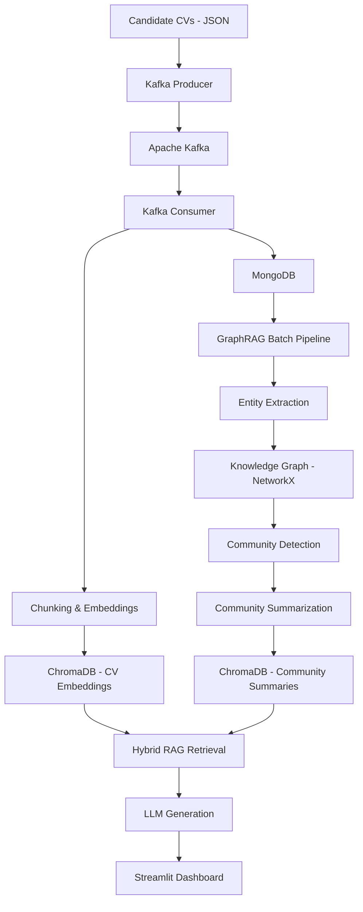
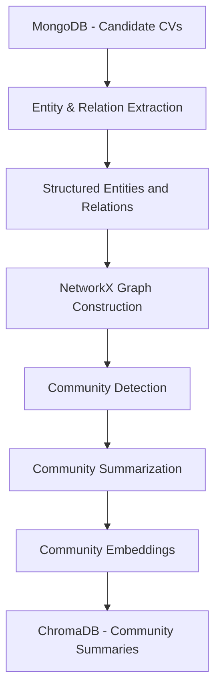

# SmartRecruit AI — Intelligent Recruitment & Hybrid GraphRAG

[](https://opensource.org/licenses/MIT)

**An AI-powered Applicant Tracking System (ATS) combining semantic search, knowledge graphs, and Retrieval-Augmented Generation (RAG) to transform how recruiters explore and analyze candidate profiles.**

<p align="center">

  
  
  
  
  
  
  

</p>

---

## 1. Overview

SmartRecruit AI is an intelligent recruitment platform designed to help recruiters search, explore, and analyze candidate profiles using natural language.

Traditional Applicant Tracking Systems (ATS) primarily rely on keyword-based searches and predefined filters. These approaches often struggle to understand contextual relationships between skills, professional experiences, job titles, and candidate qualifications.

SmartRecruit AI addresses these limitations through an AI-driven architecture combining:

- **Event-driven data ingestion:** Apache Kafka handles the asynchronous ingestion of candidate CVs.
- **Document storage:** MongoDB stores structured candidate profiles.
- **Semantic search:** ChromaDB and multilingual embeddings enable contextual retrieval beyond exact keyword matching.
- **Hybrid GraphRAG:** Knowledge graphs and community detection provide additional insights into relationships between candidates, skills, companies, and professional domains.
- **LLM-powered generation:** Large Language Models generate contextual answers grounded in retrieved candidate information.
- **Interactive interface:** Streamlit provides a recruiter-oriented dashboard for exploring candidate profiles and querying the recruitment database.

The main objective is to move from traditional CV searching toward **context-aware, relationship-driven talent discovery**.

## 2. Key Features

| Feature | Description |
|---|---|
| CV Data Ingestion | Asynchronous ingestion of candidate profiles through Apache Kafka |
| Document Management | Structured storage of CVs in MongoDB |
| Semantic Search | Multilingual vector search using Sentence Transformers and ChromaDB |
| Hybrid Retrieval | Combination of vector-based retrieval and graph-based knowledge exploration |
| Knowledge Graph | Extraction and representation of entities and relationships between candidates, skills, companies, and domains |
| Community Detection | Identification of meaningful candidate and skill clusters using graph algorithms |
| AI-powered Answers | Contextual responses generated by an LLM using retrieved information |
| Recruiter Dashboard | Interactive interface for candidate exploration and natural-language queries |

*Features are being implemented progressively according to the project roadmap.*

## 3. System Architecture

SmartRecruit AI follows a modular, event-driven architecture with separate responsibilities for ingestion, processing, storage, retrieval, and generation.

### High-Level Architecture



### Main Components

**1. Data Ingestion Layer**

- Apache Kafka for asynchronous event streaming.
- Producer responsible for publishing CV records.
- Consumer responsible for processing incoming messages.
- Idempotent persistence to avoid duplicate candidate records.

**2. Storage Layer**

- MongoDB: stores complete candidate profiles in JSON/BSON format.
- ChromaDB: stores vector representations of CV chunks and, in a future stage, community summaries.

**3. Processing & Embedding Layer**

- CV segmentation into meaningful textual sections.
- Multilingual embedding generation.
- Semantic indexing using ChromaDB.
- Cosine similarity for vector retrieval.

**4. Knowledge Graph Layer**

- LLM-based entity and relationship extraction.
- Knowledge graph construction using NetworkX.
- Community detection using Louvain/Leiden algorithms.
- LLM-based summarization of detected communities.

**5. RAG & Generation Layer**

- Hybrid retrieval combining semantic search and graph-based information.
- Context construction using retrieved information.
- LLM-powered answer generation.
- Prompt engineering for structured and context-aware responses.

**6. Presentation Layer**

- Streamlit-based recruiter dashboard.
- Candidate profile visualization.
- Natural-language search interface.
- AI-generated contextual insights.

## 4. Hybrid GraphRAG Approach

One of the main architectural choices in SmartRecruit AI is the integration of semantic vector retrieval with graph-based knowledge exploration.

### Why Hybrid GraphRAG?

Traditional vector search is effective at retrieving semantically similar documents, but it does not explicitly represent relationships between different candidates, skills, companies, or professional experiences.

Knowledge graphs provide an additional structural representation of this information.

SmartRecruit AI combines both approaches:

| Retrieval Strategy | Purpose | Example |
|---|---|---|
| Vector Search | Retrieve relevant CV sections based on semantic similarity | Find candidates experienced in Python and Machine Learning |
| Graph Retrieval | Explore relationships between entities | Identify candidates connected to specific technologies or companies |
| Community Search | Discover broader patterns across candidate profiles | Describe the typical profile of a Data Science expert |

### Knowledge Graph Pipeline



The graph represents relationships such as:

- Candidate → possesses → Skill
- Candidate → worked at → Company
- Candidate → has experience in → Domain
- Candidate → belongs to → Professional Community

This approach enables both candidate-level retrieval and broader analysis of the talent database.

## 5. Technology Stack

| Category | Technologies | Purpose |
|---|---|---|
| Programming Language | Python 3.11 | Core development |
| Event Streaming | Apache Kafka | Asynchronous CV ingestion |
| Document Database | MongoDB 7.0 | Candidate profile storage |
| Vector Database | ChromaDB | Semantic indexing and retrieval |
| Embeddings | Sentence Transformers | Multilingual text vectorization |
| Embedding Model | paraphrase-multilingual-MiniLM-L12-v2 | Multilingual embeddings (384 dimensions) |
| RAG Framework | LangChain | Retrieval and generation orchestration |
| Knowledge Graph | NetworkX | Graph construction and traversal |
| Community Detection | Louvain / Leiden | Graph clustering |
| LLM Provider | Groq API | LLM inference |
| LLM Model | Llama 3 70B | Information extraction and generation |
| Frontend | Streamlit | Interactive recruiter dashboard |
| Containerization | Docker Compose | Infrastructure management |

## 6. Data Flow

The candidate processing pipeline follows these steps:

1. **CV Preparation:** Candidate CVs are converted into a structured JSON representation.
2. **Event Publishing:** The Kafka Producer publishes CV records to a dedicated Kafka topic.
3. **Message Consumption:** The Kafka Consumer receives and processes incoming records.
4. **Document Storage:** Complete candidate profiles are persisted in MongoDB.
5. **Text Processing:** CV content is divided into meaningful sections using text chunking.
6. **Embedding Generation:** Each section is transformed into a multilingual vector.
7. **Vector Indexing:** Embeddings and metadata are stored in ChromaDB.
8. **Knowledge Extraction:** The GraphRAG pipeline extracts entities and relationships from candidate profiles.
9. **Graph Construction:** NetworkX builds a knowledge graph and identifies candidate communities.
10. **Intelligent Retrieval:** The RAG layer combines relevant vector and graph information.
11. **Answer Generation:** The LLM generates responses based on the retrieved context.

## 7. Project Structure

```text
smartrecruit-ai/
│
├── config/                 # Centralized application configuration
│
├── data/
│   ├── sample_cvs/         # Sample candidate profiles
│   └── raw/                # Original datasets (not versioned)
│
├── ingestion/              # Kafka producer and consumer
│
├── processing/             # CV chunking and embedding generation
│
├── storage/                # MongoDB and ChromaDB clients
│
├── generation/             # LLM client and generation utilities
│
├── graph/                  # Knowledge graph and GraphRAG components
│
├── rag/                    # Retrieval pipeline and prompts
│
├── interface/              # Streamlit application and UI components
│
├── scripts/                # Data preparation and diagnostic scripts
│
├── tests/                  # Unit and integration tests
│
├── chroma_data/            # Local vector database persistence
│
├── docker-compose.yml      # Infrastructure configuration
├── requirements.txt        # Python dependencies
├── claude.md               # Internal development context
├── .env                    # Environment variables (not versioned)
├── .gitignore
└── README.md
```

## 8. Getting Started

### Prerequisites

Make sure you have installed:

- Python 3.11
- Docker Desktop
- Docker Compose
- Git
- A Groq API key

### 1. Clone the Repository

```bash
git clone https://github.com/YOUR_USERNAME/smartrecruit-ai.git
cd smartrecruit-ai
```

### 2. Create a Virtual Environment

**Windows PowerShell:**

```powershell
py -3.11 -m venv .venv
.venv\Scripts\Activate.ps1
```

### 3. Install Dependencies

```bash
pip install -r requirements.txt
```

### 4. Configure Environment Variables

Create a `.env` file in the project root:

```env
# Kafka
KAFKA_BOOTSTRAP_SERVERS=localhost:9092
KAFKA_TOPIC=cv-ingestion

# MongoDB
MONGO_URI=mongodb://localhost:27017
MONGO_DB_NAME=smartrecruit
MONGO_COLLECTION=cvs

# ChromaDB
CHROMA_PERSIST_DIR=./chroma_data
CHROMA_COLLECTION=cv_embeddings

# Embeddings
EMBEDDING_MODEL=paraphrase-multilingual-MiniLM-L12-v2

# LLM
LLM_PROVIDER=groq
LLM_MODEL=llama3-70b-8192
GROQ_API_KEY=your_groq_api_key

# Streamlit
STREAMLIT_PORT=8501
```

**Important:** Never commit your `.env` file or expose API keys and credentials in your repository.

### 5. Start Infrastructure

```bash
docker compose up -d
```

Verify running containers:

```bash
docker compose ps
```

### 6. Run the Application

```bash
streamlit run interface/app.py
```

Open your browser at:

```text
http://localhost:8501
```

*Note: The application interface and complete end-to-end workflow are still under development.*

## 9. Development Roadmap

| Phase | Description | Status |
|---|---|---|
| Phase 0 | Project foundations, environment and dataset preparation | Completed |
| Phase 1 | Kafka-based ingestion pipeline and MongoDB persistence | Completed |
| Phase 2 | CV chunking, multilingual embeddings and semantic indexing | Completed |
| Phase 3 | Hybrid GraphRAG, knowledge graph and community detection | In Progress |
| Phase 4 | Streamlit dashboard and recruiter-oriented interface | Planned |

### Current Implementation

**Completed milestones:**

- Modular project architecture.
- Docker infrastructure setup.
- Kafka Producer/Consumer pipeline.
- MongoDB document persistence.
- Idempotent CV ingestion.
- CV chunking and embedding generation.
- Multilingual semantic indexing in ChromaDB.
- Initial semantic search validation.

**Upcoming milestones:**

- LLM-based entity and relation extraction.
- NetworkX knowledge graph construction.
- Louvain/Leiden community detection.
- Community-level summarization and indexing.
- Hybrid retrieval and RAG orchestration.
- Interactive recruiter dashboard.

## 10. Engineering Principles

The project follows several software engineering principles:

- **Separation of Concerns:** Each module has a clearly defined responsibility.
- **Modularity:** Storage, ingestion, processing, retrieval, and generation are independent components.
- **Centralized Configuration:** Application settings are managed through a single configuration module.
- **Idempotent Processing:** Reprocessing a CV should not create duplicate records.
- **Incremental Development:** Each development phase has explicit validation criteria.
- **Reproducibility:** Docker and Python virtual environments provide a consistent development setup.

## 11. Project Objectives & Learning Outcomes

SmartRecruit AI is an engineering project focused on the practical integration of modern Data Engineering and Generative AI technologies.

It explores:

- Event-driven architectures and distributed data ingestion.
- Data processing and document-oriented storage.
- Vector databases and multilingual semantic search.
- Retrieval-Augmented Generation (RAG).
- Knowledge Graphs and Graph-based Retrieval.
- LLM-based information extraction and generation.
- Modular Python application design.
- AI-powered recruitment and intelligent information discovery.

## 12. References

- [Microsoft Research — From Local to Global: A Graph RAG Approach to Query-Focused Summarization](https://arxiv.org/abs/2404.16130)
- [Apache Kafka Documentation](https://kafka.apache.org/documentation/)
- [MongoDB Documentation](https://www.mongodb.com/docs/)
- [ChromaDB Documentation](https://docs.trychroma.com/)
- [LangChain Documentation](https://docs.langchain.com/)
- [Sentence Transformers Documentation](https://sbert.net/)
- [NetworkX Documentation](https://networkx.org/documentation/stable/)
- [Streamlit Documentation](https://docs.streamlit.io/)

---

## Author

**Mohammed Solimani**

AI & Data Science Engineering Student

Interested in Generative AI, Agentic AI, Data Engineering, RAG Systems, and Microservices Architecture.

## License

This project is licensed under the MIT License.
See the [LICENSE](LICENSE) file for details.

---

*SmartRecruit AI — Making recruitment more intelligent through data, knowledge graphs, and generative AI.*