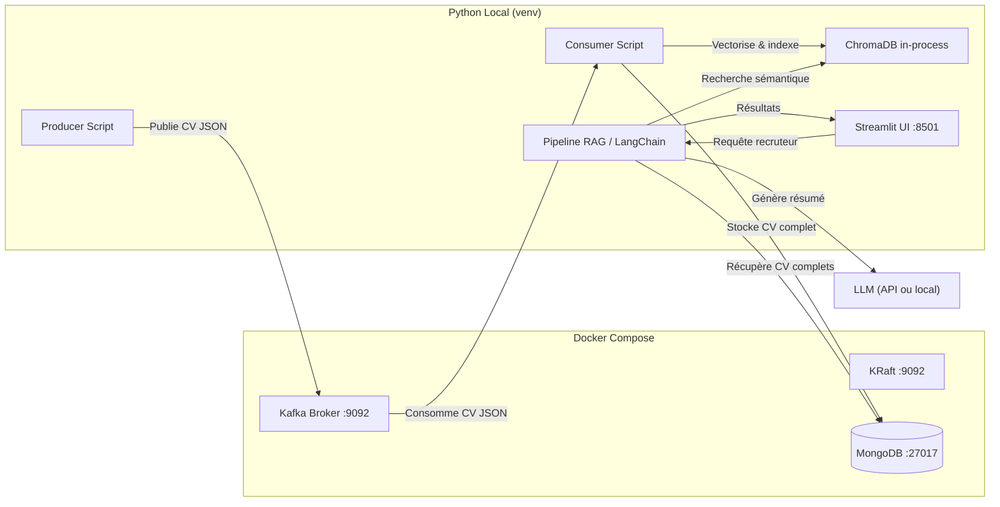
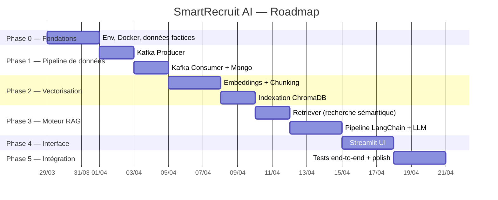

# SmartRecruit AI — Document d'Architecture & Plan de Conception

> **Phase** : Conception — Aucune ligne de code applicatif à ce stade.
> **Auteur** : Mohammed Solimani
> **Date** : 29 mars 2026

---

## Table des matières

1. [Prérequis & Recherche](#1--prérequis--recherche)
2. [Architecture d'Intégration](#2--architecture-dintégration)
3. [Stratégie de Collaboration](#3--stratégie-de-collaboration-git--environnement)
4. [Structure du Projet](#4--structure-du-projet-arborescence)
5. [Roadmap d'Implémentation](#5--roadmap-dimplémentation)
6. [Fondations — Par quoi commencer aujourd'hui](#6--fondations--par-quoi-commencer-aujourdhui)

---

## 1 — Prérequis & Recherche

### 1.1 Concepts fondamentaux à maîtriser

| Domaine | Concept | Pourquoi c'est critique | Ressource recommandée |
|---|---|---|---|
| **NLP / Embeddings** | Embeddings vectoriels & similarité cosinus | C'est le cœur du moteur de recherche sémantique. Un embedding transforme du texte en vecteur numérique ; la similarité cosinus mesure la « proximité » sémantique entre deux vecteurs. | [SBERT docs](https://www.sbert.net/) + article *"Understanding Word Embeddings"* |
| **NLP / Embeddings** | Chunking de texte | Un CV peut être trop long pour un seul embedding. Il faut le découper en segments cohérents (par section : expérience, formation, compétences) pour que la recherche soit granulaire. | LangChain docs — *Text Splitters* |
| **NLP / Embeddings** | Modèles `sentence-transformers` | Savoir choisir un modèle (ex: `all-MiniLM-L6-v2` pour la vitesse ou `all-mpnet-base-v2` pour la qualité), comprendre la dimension du vecteur de sortie. | HuggingFace Model Hub |
| **RAG** | Pipeline RAG (Retrieve → Augment → Generate) | La recherche ne se résume pas à retrouver des vecteurs. Il y a 3 étapes : retrouver les chunks pertinents, construire un prompt contextuel, puis générer la réponse via un LLM. | LangChain docs — *RAG Quickstart* |
| **Streaming** | Kafka : Topics, Partitions, Consumer Groups | Comprendre pourquoi Kafka utilise des topics (canaux de messages), des partitions (parallélisme) et des consumer groups (scalabilité des lecteurs). Pour le PFA, un seul topic et un seul consumer suffisent. | [Kafka Intro — Confluent](https://developer.confluent.io/what-is-apache-kafka/) |
| **Streaming** | Sérialisation JSON dans Kafka | Les messages Kafka sont des bytes. Il faut sérialiser/désérialiser en JSON. | Docs `kafka-python` ou `confluent-kafka` |
| **BDD** | MongoDB : Documents & Collections | Mongo stocke des documents JSON. Chaque CV = 1 document. Comprendre les opérations CRUD de base et les index. | [MongoDB University — M001](https://university.mongodb.com/) |
| **Vecteurs** | ChromaDB : Collection, `add`, `query` | ChromaDB est une base vectorielle légère. Comprendre comment créer une collection, y insérer des embeddings avec métadonnées, et lancer une requête par similarité. | [ChromaDB Getting Started](https://docs.trychroma.com/) |
| **DevOps** | Docker & Docker Compose | Savoir ce qu'est un conteneur, un réseau Docker, un volume. Comprendre `docker-compose.yml` (services, ports, depends_on). | Docker Docs — *Get Started* |

### 1.2 Ce que vous pouvez ignorer (pour l'instant)

- Le fine-tuning de modèles — vous utilisez des modèles pré-entraînés.
- Kafka Streams / KSQL — surdimensionné pour ce projet.
- Les schémas Avro / Protobuf — JSON brut suffit.
- Le déploiement cloud — vous restez en local.

---

## 2 — Architecture d'Intégration

### 2.1 Vue d'ensemble



### 2.2 Stratégie de conteneurisation

> [!IMPORTANT]
> **Recommandation : Conteneuriser uniquement l'infrastructure, pas les applications Python.**

| Composant | Conteneurisé ? | Raison |
|---|---|---|
| Kafka + KRaft | ✅ Oui | Installation native complexe et non reproductible. Docker est la norme. |
| MongoDB | ✅ Oui | Identique sur les deux machines, données persistées via un volume Docker. |
| ChromaDB | ❌ Non | Utilisé en mode *in-process* (librairie Python). Pas besoin de serveur séparé pour un PFA. Les données sont stockées dans un dossier local (`./chroma_data/`). |
| Scripts Python | ❌ Non | Vous avez besoin d'un cycle de développement rapide (edit → run → debug). Un virtualenv partagé via `requirements.txt` suffit. |
| Streamlit | ❌ Non | Même raison. Lancer `streamlit run app.py` directement est plus pratique. |

### 2.3 Réseau & Communication

```
┌─────────────────────────────────────────────┐
│            Réseau Docker : smartrecruit-net  │
│                                              │
│   ┌──────────┐       ┌──────────┐           │
│   │  KRaft   │◄──────│  Kafka   │           │
│   │  :9092   │       │  :9092   │           │
│   └──────────┘       └──┬───────┘           │
│                          │ Port exposé       │
│   ┌──────────┐          │ localhost:9092     │
│   │ MongoDB  │          │                    │
│   │  :27017  │──────────┼─ Port exposé       │
│   └──────────┘          │ localhost:27017     │
└─────────────────────────┼────────────────────┘
                          │
        ┌─────────────────┼─────────────────┐
        │  Machine locale (Python venv)     │
        │                                    │
        │  Scripts → localhost:9092 (Kafka)  │
        │  Scripts → localhost:27017 (Mongo) │
        │  ChromaDB → ./chroma_data/        │
        │  Streamlit → localhost:8501        │
        └────────────────────────────────────┘
```

- Les scripts Python tournent **sur la machine hôte** et accèdent aux services Docker via `localhost`.
- Toutes les adresses/ports sont centralisés dans un fichier `.env`.

### 2.4 Variables d'environnement (`.env`)

```env
# --- Infrastructure ---
KAFKA_BOOTSTRAP_SERVERS=localhost:9092
KAFKA_TOPIC=cv-ingestion
MONGO_URI=mongodb://localhost:27017
MONGO_DB_NAME=smartrecruit
MONGO_COLLECTION=cvs

# --- ChromaDB ---
CHROMA_PERSIST_DIR=./chroma_data
CHROMA_COLLECTION=cv_embeddings

# --- Embeddings ---
EMBEDDING_MODEL=all-MiniLM-L6-v2

# --- LLM (exemple avec Ollama local ou API OpenAI) ---
LLM_PROVIDER=ollama
LLM_MODEL=mistral
# Ou si utilisation d'une API :
# OPENAI_API_KEY=sk-...

# --- Streamlit ---
STREAMLIT_PORT=8501
```

---

## 3 — Stratégie de Collaboration (Git & Environnement)

### 3.1 Structure du dépôt Git

- **Un seul dépôt GitHub** (monorepo) pour tout le projet.
- **Branche `main`** : Toujours stable et fonctionnelle.
- **Branche `develop`** : Branche d'intégration. Les merge se font ici.
- **Branches de feature** : `feature/<nom-du-module>` (ex: `feature/kafka-consumer`, `feature/rag-pipeline`).

```
main ─────────────────────────────────────────►
  │
  └── develop ────────────────────────────────►
        │           │
        ├── feature/kafka-producer
        ├── feature/kafka-consumer
        ├── feature/rag-pipeline
        └── feature/streamlit-ui
```

### 3.2 Workflow quotidien

1. Chacun crée une branche `feature/xxx` depuis `develop`.
2. Travailler, commiter régulièrement (commits atomiques et descriptifs).
3. Pousser sur GitHub et ouvrir une **Pull Request** vers `develop`.
4. L'autre binôme fait une **revue rapide** (même un simple regard).
5. Merger dans `develop`. Quand `develop` est stable → merger dans `main`.

### 3.3 Fichiers de configuration partagés

| Fichier | Rôle | Versionné ? |
|---|---|---|
| `requirements.txt` | Dépendances Python avec versions figées | ✅ Oui |
| `.env` | Variables d'environnement réelles (peut contenir des clés API) | ❌ Non (dans `.gitignore`) |
| `docker-compose.yml` | Infrastructure (Kafka, Mongo) | ✅ Oui |
| `.gitignore` | Exclusions Git | ✅ Oui |
| `chroma_data/` | Données vectorielles locales | ❌ Non (dans `.gitignore`) |

### 3.4 `.gitignore` recommandé

```gitignore
# Python
__pycache__/
*.pyc
.venv/
venv/

# Environnement
.env

# Données locales
chroma_data/
data/generated/

# IDE
.vscode/
.idea/
*.swp
```

### 3.5 Synchronisation des environnements

```bash
# Étudiant A installe une nouvelle dépendance :
pip install langchain
pip freeze > requirements.txt
git add requirements.txt && git commit -m "deps: add langchain"
git push

# Étudiant B récupère :
git pull
pip install -r requirements.txt
```

> [!TIP]
> Au premier clone du projet, chaque binôme exécute :
> ```bash
> python -m venv .venv
> .venv\Scripts\activate   # Windows
> pip install -r requirements.txt
> cp .env.example .env     # Puis ajuster si nécessaire
> docker compose up -d
> ```

---

## 4 — Structure du Projet (Arborescence)

```
smartrecruit-ai/
│
├── docker-compose.yml          # Infrastructure (Kafka, KRaft, MongoDB)
├── requirements.txt            # Dépendances Python
├── .env                        # Variables d'env réelles
├── .gitignore
├── README.md
│
├── config/
│   └── settings.py             # Chargement centralisé des variables d'env (python-dotenv)
│
├── data/
│   ├── sample_cvs/             # CV JSON factices pour les tests
│   └── generated/              # Données générées par les scripts (non versionné)
│
├── ingestion/
│   ├── __init__.py
│   ├── producer.py             # Kafka Producer — lit les CV JSON et les publie
│   └── consumer.py             # Kafka Consumer — consomme, stocke dans Mongo, vectorise
│
├── processing/
│   ├── __init__.py
│   ├── embeddings.py           # Logique d'embedding (sentence-transformers)
│   └── chunking.py             # Découpage des CV en sections (chunking)
│
├── rag/
│   ├── __init__.py
│   ├── retriever.py            # Recherche dans ChromaDB
│   ├── chain.py                # Pipeline LangChain RAG (prompt + LLM)
│   └── prompts.py              # Templates de prompts
│
├── storage/
│   ├── __init__.py
│   ├── mongo_client.py         # Connexion et opérations MongoDB
│   └── chroma_client.py        # Connexion et opérations ChromaDB
│
├── interface/
│   ├── app.py                  # Application Streamlit principale
│   └── components/             # Composants UI réutilisables (widgets Streamlit)
│       └── result_card.py
│
├── scripts/
│   └── generate_fake_cvs.py    # Script de génération de données factices (Faker)
│
└── tests/
    ├── test_embeddings.py
    ├── test_chunking.py
    ├── test_mongo.py
    └── test_chroma.py
```

> [!NOTE]
> **Pourquoi cette structure ?**
> - Chaque module a une **responsabilité unique** (SRP).
> - `config/settings.py` est le **point d'entrée unique** pour toutes les variables d'env → pas de `os.getenv()` éparpillé partout.
> - `storage/` isole les clients de base de données → si vous changez de BDD, vous ne touchez qu'un fichier.
> - `tests/` permet de valider chaque module de manière isolée.

---

## 5 — Roadmap d'Implémentation

### Vue chronologique



### Détail par phase

#### Phase 0 — Fondations (Jour 1-3)
- [ ] Créer le dépôt GitHub et la structure de dossiers
- [ ] Écrire `docker-compose.yml` (Kafka + Zookeeper + MongoDB)
- [ ] Configurer `requirements.txt`, `.gitignore`
- [ ] Écrire `config/settings.py` (chargement centralisé)
- [ ] Écrire `scripts/generate_fake_cvs.py` (générer 50-100 CV JSON avec `Faker`)
- [ ] Vérifier que les deux machines fonctionnent : `docker compose up`, `pip install`, le script tourne

#### Phase 1 — Pipeline de données (Jour 4-7)
- [ ] `ingestion/producer.py` : lire les CV JSON, les publier sur le topic Kafka
- [ ] `ingestion/consumer.py` : consommer les messages, les stocker dans MongoDB
- [ ] **Test** : publier 10 CV → vérifier qu'ils apparaissent bien dans MongoDB

#### Phase 2 — Vectorisation (Jour 8-12)
- [ ] `processing/chunking.py` : découper un CV JSON en chunks textuels (par section)
- [ ] `processing/embeddings.py` : générer les embeddings avec `sentence-transformers`
- [ ] `storage/chroma_client.py` : stocker les embeddings dans ChromaDB
- [ ] Intégrer dans le consumer : après insertion Mongo → chunking → embedding → ChromaDB
- [ ] **Test** : vérifier qu'une recherche par similarité retourne des résultats cohérents

#### Phase 3 — Moteur RAG (Jour 13-17)
- [ ] `rag/retriever.py` : recherche sémantique dans ChromaDB + récupération CV complets dans Mongo
- [ ] `rag/prompts.py` : templates de prompts pour le LLM
- [ ] `rag/chain.py` : pipeline LangChain (Retriever → Prompt → LLM → Réponse)
- [ ] **Test** : « Trouve-moi un développeur Python avec 3 ans d'expérience » → vérifier la pertinence

#### Phase 4 — Interface Streamlit (Jour 18-20)
- [ ] `interface/app.py` : champ de recherche, bouton, affichage des résultats
- [ ] `interface/components/result_card.py` : carte profil (nom, résumé, compétences, score)
- [ ] Connecter l'interface au pipeline RAG

#### Phase 5 — Intégration & Polish (Jour 21-23)
- [ ] Test end-to-end complet : ingestion → recherche → résultat affiché
- [ ] Rédiger le `README.md` final
- [ ] Préparer la démonstration / soutenance

---

## 6 — Fondations — Par quoi commencer aujourd'hui

### Étape 1 : Créer le dépôt et la structure

```bash
# Un des deux binômes crée le dépôt sur GitHub : smartrecruit-ai (privé)
# Puis :
git clone https://github.com/<votre-user>/smartrecruit-ai.git
cd smartrecruit-ai

# Créer la structure de dossiers
mkdir config data data/sample_cvs ingestion processing rag storage interface interface/components scripts tests
```

### Étape 2 : Docker Compose (infrastructure)

Créer `docker-compose.yml` avec :
- **Zookeeper** (image `confluentinc/cp-zookeeper:7.5.0`) → port 2181
- **Kafka** (image `confluentinc/cp-kafka:7.5.0`) → port 9092, lié à Zookeeper
- **MongoDB** (image `mongo:7.0`) → port 27017, volume persistant

Le réseau Docker `smartrecruit-net` relie ces trois services.

### Étape 3 : Environnement Python

```bash
python -m venv .venv
.venv\Scripts\activate          # Windows

pip install kafka-python pymongo chromadb sentence-transformers langchain streamlit python-dotenv Faker torch
pip freeze > requirements.txt
```

### Étape 4 : Fichier de configuration centralisé

Le fichier `config/settings.py` chargera toutes les variables d'env via `python-dotenv` et exposera des constantes Python. Tout le reste du projet importera depuis ce module.

### Étape 5 : Générer des données factices

Le script `scripts/generate_fake_cvs.py` utilisera `Faker` pour produire 50-100 CV au format JSON avec cette structure cible :

```json
{
  "id": "cv-001",
  "name": "Marie Dupont",
  "email": "marie.dupont@email.com",
  "phone": "+33 6 12 34 56 78",
  "title": "Développeuse Full Stack",
  "summary": "5 ans d'expérience en développement web...",
  "skills": ["Python", "Django", "React", "PostgreSQL", "Docker"],
  "experience": [
    {
      "company": "TechCorp",
      "role": "Développeuse Senior",
      "duration": "2022-2025",
      "description": "Développement d'une plateforme SaaS..."
    }
  ],
  "education": [
    {
      "institution": "Université Paris-Saclay",
      "degree": "Master Informatique",
      "year": "2020"
    }
  ],
  "languages": ["Français", "Anglais"],
  "location": "Paris, France"
}
```

### Étape 6 : Valider la base

À la fin de cette journée, **les deux binômes doivent pouvoir** :

1. ✅ Cloner le repo et installer les dépendances
2. ✅ Lancer `docker compose up -d` sans erreur
3. ✅ Se connecter à Mongo (`mongosh` ou un client GUI)
4. ✅ Voir le broker Kafka tourner (`docker compose logs kafka`)
5. ✅ Exécuter le script de génération de CV factices
6. ✅ Lire les CV générés en JSON dans `data/sample_cvs/`

---

## Point de décision pour l'équipe

> [!WARNING]
> **Choix du LLM à trancher avant la Phase 3 :**
> - **Option A — Ollama (local, gratuit)** : Installer Ollama + modèle `mistral` ou `llama3`. Pas de clé API, mais nécessite ~8 Go de RAM et un GPU aide.
> - **Option B — API OpenAI** : Plus simple à intégrer via LangChain, mais nécessite une clé API (payante).
> - **Option C — API Groq (gratuite)** : Très rapide, gratuit en tier libre, modèles Llama/Mistral hébergés. Bonne alternative.
>
> Discutez-en et décidez avant de commencer la Phase 3.

---

*Ce document est votre feuille de route. Validez-le, puis nous passerons au code module par module.*
