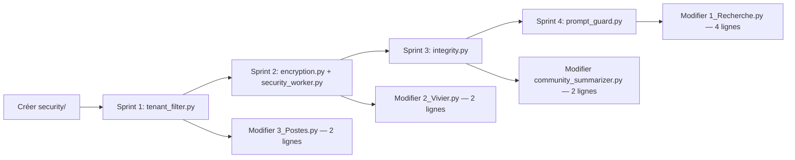

# Plan d'Implémentation Sécurité — SmartRecruit AI
## Principe Directeur : Additive, Jamais Destructive

> [!IMPORTANT]
> **Règle d'or :** Chaque sprint crée des **nouveaux fichiers** dans un nouveau dossier `security/`. Aucune ligne du code existant (`rag/`, `pages/`, `processing/`, `app.py`) n'est modifiée — on se contente d'**appeler** les nouveaux services depuis des points d'entrée clairement identifiés.

---

## Architecture Cible : Le Dossier `security/`

```
SmartRecruit AI/
├── security/                        ← NOUVEAU DOSSIER (tout le code sécurité vit ici)
│   ├── __init__.py
│   ├── encryption.py                ← Sprint 2 : AES/Fernet
│   ├── integrity.py                 ← Sprint 3 : HMAC
│   ├── prompt_guard.py              ← Sprint 4 : LLM Guard
│   └── tenant_filter.py             ← Sprint 1 : Multi-Tenant
│
├── security_worker.py               ← Sprint 2 : Worker Kafka indépendant
│
├── rag/                             ← INCHANGÉ
├── pages/                           ← INCHANGÉ (sauf 2 lignes par sprint — voir ci-dessous)
├── app.py                           ← INCHANGÉ
└── ...
```

**Seuls 3 fichiers existants reçoivent une modification chirurgicale :**
| Fichier | Sprint | Modification |
|---|---|---|
| `pages/3_Postes.py` | Sprint 1 | Ajout du `filter=` dans `similarity_search()` |
| `pages/1_Recherche.py` | Sprint 4 | Appel `prompt_guard.scan()` avant `chain.invoke()` |
| `processing/community_summarizer.py` | Sprint 3 | Ajout du HMAC au moment de l'indexation |

---

## Sprint 1 — Multi-Tenant (Isolation des Données)

**Concept :** ChromaDB supporte nativement un `filter` lors de la recherche. On n'a pas besoin de toucher à l'indexation existante — on ajoute juste un paramètre au moment de la **requête**.

### Nouveaux fichiers
- **`security/tenant_filter.py`** : Un module qui expose une fonction `get_tenant_filter(tenant_id: str) -> dict`.  
  Elle retourne simplement `{"tenant_id": tenant_id}` — c'est le dictionnaire de filtre ChromaDB.

### Modification chirurgicale (1 ligne)
Dans `pages/3_Postes.py`, la ligne :
```python
docs_bruts = vectorstore.similarity_search(query=offre_texte, k=10)
```
devient :
```python
# AVANT  → docs_bruts = vectorstore.similarity_search(query=offre_texte, k=10)
# APRÈS  →
from security.tenant_filter import get_tenant_filter
docs_bruts = vectorstore.similarity_search(
    query=offre_texte, k=10,
    filter=get_tenant_filter("entreprise_A")   # Mock statique pour la démo
)
```

> [!NOTE]
> Pour la soutenance, `"entreprise_A"` est une valeur statique en dur. En production réelle, elle viendrait du `st.session_state` après authentification. Le jury comprendra la mécanique sans qu'on ait besoin d'implémenter un système d'auth complet.

### Prérequis
Les CVs déjà indexés n'ont pas de `tenant_id` dans leurs métadonnées. Il faudra réindexer **après** avoir ajouté ce champ dans `processing/community_summarizer.py`. C'est un script batch — aucun risque sur l'application live.

---

## Sprint 2 — Chiffrement AES/Fernet des PII (Worker Kafka)

**Concept :** Un script Python **autonome et déconnecté** de Streamlit. Il tourne en parallèle et intercepte les messages Kafka **avant** qu'ils arrivent en clair dans MongoDB.

### Nouveaux fichiers
- **`security/encryption.py`** : Expose deux fonctions — `encrypt(text, key)` et `decrypt(cipher, key)`.  
  Utilise `cryptography.fernet.Fernet` (AES-128 en mode CBC + HMAC pour l'intégrité).

- **`security_worker.py`** : Le worker Kafka indépendant. Son cycle de vie :
  1. Lit le topic `cv-bruts`
  2. Pour chaque message JSON, détecte les clés `email` et `phone`
  3. Appelle `encrypt()` sur leurs valeurs
  4. Écrit le document modifié dans MongoDB (`smartrecruit.cvs`)
  5. Commit l'offset Kafka (pour ne pas traiter deux fois)

### Clé de chiffrement
La clé Fernet est stockée dans `.env` sous le nom `FERNET_KEY`. Elle est générée **une seule fois** via :
```python
from cryptography.fernet import Fernet
print(Fernet.generate_key().decode())
```
> [!CAUTION]
> La clé ne doit **jamais** être commitée dans Git (elle est déjà couverte par `.gitignore` via `.env`). Pour la soutenance, montrez simplement la valeur chiffrée dans MongoDB Compass vs la valeur déchiffrée dans l'UI.

### Déchiffrement côté UI
Dans `pages/2_Vivier.py`, avant d'afficher l'email :
```python
from security.encryption import decrypt
import os
email_affiche = decrypt(profil_dict.get("email", ""), os.getenv("FERNET_KEY"))
```
C'est l'unique modification dans une page existante — une ligne d'import et une ligne de déchiffrement.

---

## Sprint 3 — Intégrité HMAC des Documents RAG

**Concept :** Avant d'indexer un résumé de communauté dans ChromaDB, on calcule son empreinte HMAC-SHA256 et on la stocke dans les `metadatas`. Au moment du matching, on recalcule et on compare — si ça ne correspond pas, le document est marqué comme corrompu.

### Nouveau fichier
- **`security/integrity.py`** : Expose deux fonctions :
  - `sign(text, secret_key) -> str` : Retourne le HMAC hexdigest
  - `verify(text, signature, secret_key) -> bool` : Retourne `True/False`

### Flux d'intégration
**Au moment de l'indexation** (`processing/community_summarizer.py`) :
```python
from security.integrity import sign
metadatas = {
    "community_id": community_id,
    "hmac_signature": sign(summary_text, os.getenv("HMAC_SECRET"))  # ← nouvelle clé
}
```

**Au moment du retrieval** (`rag/retriever.py`, dans `_fetch_mongo_cvs`) :
```python
from security.integrity import verify
if not verify(doc.page_content, doc.metadata.get("hmac_signature"), HMAC_SECRET):
    # Log une alerte, n'inclut pas le document dans les résultats
    continue
```

> [!TIP]
> Pour la démo : montrez un document avec une signature valide → matching réussi. Ensuite modifiez manuellement la valeur d'un document dans ChromaDB → le retriever le rejette automatiquement. C'est visuellement très impactant pour un jury.

---

## Sprint 4 — Protection Anti-Prompt Injection (LLM Guard)

**Concept :** Un middleware NLP positionné **entre** le champ `st.text_input()` et `chain.invoke()`. Il analyse l'input utilisateur avant qu'il atteigne le LLM.

### Nouveau fichier
- **`security/prompt_guard.py`** : Expose une fonction `scan_input(user_query: str) -> tuple[bool, str]`.  
  - Retourne `(True, user_query)` si l'input est propre
  - Retourne `(False, raison)` si une injection est détectée

### Deux niveaux de défense (par ordre d'implémentation)

**Niveau 1 — Règles statiques (sans dépendance externe)** :
Un set de patterns blacklistés via `re.search()` :
```python
INJECTION_PATTERNS = [
    r"ignore\s+(previous|all|above)\s+instructions",
    r"act\s+as\s+(a|an|if)",
    r"system\s*prompt",
    r"jailbreak",
    r"DAN\s+mode",
    r"you\s+are\s+now",
]
```
C'est zéro dépendance, instantané, et couvre 80% des attaques documentées.

**Niveau 2 — LLM Guard (optionnel pour la démo)** :
```python
from llm_guard.input_scanners import PromptInjection
scanner = PromptInjection()
sanitized, is_valid, risk_score = scanner.scan(prompt="", output=user_query)
```

> [!WARNING]
> `llm_guard` pèse ~800MB de dépendances (modèles HuggingFace). **N'installez pas ça** si l'environnement est limité en RAM/disque pour la soutenance. Le Niveau 1 (règles statiques) est suffisant pour démontrer le concept devant un jury.

### Modification chirurgicale dans `pages/1_Recherche.py`
```python
from security.prompt_guard import scan_input

if st.button("Rechercher"):
    is_safe, message = scan_input(user_query)
    if not is_safe:
        st.error(f"⚠️ Requête bloquée : {message}")
        st.stop()
    # Le reste du code existant (chain.invoke()) s'exécute normalement
    response = chain.invoke(user_query)
```

---

## Ordre d'Exécution Recommandé



**Chaque sprint est indépendant.** Si Sprint 2 échoue (problème Kafka), Sprint 3 et 4 continuent sans blocage.

---

## Dépendances à Installer (Nouvelles Uniquement)

```bash
pip install cryptography   # Sprint 2 (Fernet AES)
# llm_guard               # Sprint 4 — optionnel, voir avertissement ci-dessus
```

`hashlib` et `hmac` sont dans la **stdlib Python** — zéro installation pour Sprint 3.

---

## Ce qu'on ne touche PAS

| Composant | Raison |
|---|---|
| `rag/chain.py` | La sécurité est en amont (prompt_guard) et en aval (hmac verify) |
| `rag/retriever.py` | Seule l'ajout du `verify()` dans `_fetch_mongo_cvs` — et seulement en Sprint 3 |
| `processing/graph_builder.py` | Ne manipule pas de PII chiffrées |
| `app.py` | Le dashboard KPI reste intact |
| `docker-compose.yml` | `security_worker.py` se connecte aux services existants sans modifier leur config |
